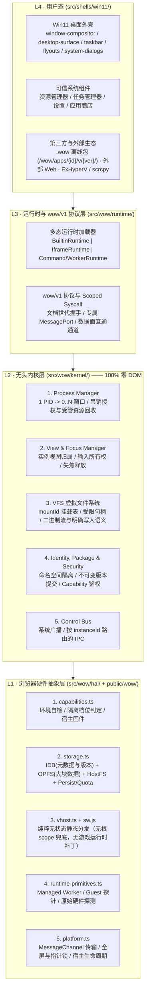

# WinOnWeb (WOW) 架构规范 v2（定稿）

> **状态**：v2 定稿（已吸收 Codex 深度架构审核与全部 5 项核心拍板）  
> **运行形态**：纯浏览器运行（手机/桌面通用），不上桌面端套壳，不依赖浏览器扩展。  
> **演进策略**：0.1.0 开发期彻底推倒重命名，**不保留历史兼容代码**，**不背负旧版 `localStorage` / `IndexedDB` 数据迁移包袱**，同步切换 `package.json` 导出、包构建器与样例。

---

## 1. 愿景与定位

**WinOnWeb (WOW)** 是一个运行在浏览器中的**跨平台元操作系统（Browser Meta-OS）**：
1. **跨芯片、跨平台，一次打包到处运行**：依托标准 Web 与 WebAssembly（结合 AI 极速生成 Web 应用的能力），提供官方应用商店并支持用户自主上传/侧载 `.wow` 应用包。
2. **通用底座支撑多元外部生态**：通过通用操作系统原语（后台常驻进程、多窗口、输入焦点治理、数据面直通），自然承载重型 Wasm 3D 游戏、在线工具，以及未来的 **ExHyperV 虚拟机控制台**、**scrcpy 安卓端**等外部应用，无需在内核中写死任何远程控制特例。
3. **内核与外壳彻底解耦**：`WOW` 是操作系统本体（`src/wow/`），`Win11` 只是运行在其上的默认桌面外壳（`src/shells/win11/`）。

---

## 2. 五项核心架构决策（已拍板）

1. **应用隔离与部署拓扑（双模式）**：
   - 架构按 **“可信 Shell 独立源 + 每个不互信应用独立非特权源（通配子域）”** 设计，授权账本与核心注册表只存在可信 Shell 源中。
   - 同时保留 **“单域名受信模式”** 档位（开发期及单域静态托管下使用 `/wow/apps/{id}/`，明确仅运行官方/受信包，不宣称浏览器防同源恶意代码）。
   - **严格应用身份**：保留系统与宿主命名空间；安装时校验来源与内容摘要；升级校验同一发布者，权限扩大必须重新授权；侧载包获得独立安装身份，同名不得覆盖或继承已有授权。
2. **多线程 Wasm 与外站嵌入（纯浏览器无插件）**：
   - 主站优先采用 **`COEP: credentialless`（无凭证隔离模式）** 搭配 `COOP: same-origin`（不支持该模式的浏览器如 Safari 自动降级兼容），在保住多线程 Wasm 性能的同时放行允许嵌入的外部网页与资源。
   - **显式双档启动**：多线程 Wasm 走**隔离计算档**（在 Guest 真实上下文中校验 `crossOriginIsolated` / `SharedArrayBuffer`，不足时降级单线程入口或明确提示，绝不黑屏崩溃）；外部网站走**兼容档**（遇到 `X-Frame-Options` / `frame-ancestors` 拒嵌站点提供一键新标签页打开）。
   - 明确写清第三方宿主（如 ExHyperV 嵌套 WOW）必须返回的响应头与委派能力。
3. **面向 ExHyperV / scrcpy 与重型应用的通用内核原语**：
   - **不向内核引入远程控制特例**，而是把需求抽象为 3 项通用 OS 能力：
     - **进程与窗口解耦**：`1 Process (PID)` 可关联 `0 ~ N` 个 `Window (WID)`，原生支持关窗后台保活与单进程多窗口；
     - **通用输入焦点协议**：明确键鼠输入所有权，失焦/断线/解锁时统一派发输入释放事件，防止卡键；
     - **控制面与数据面分离**：控制面（鉴权、生命周期、窗口管理）走内核；数据面（大文件块、音视频流、WebRTC/WebSocket 帧）由 Runtime 持授权直通消费者，不阻塞内核总线。
4. **安装一致性与分层存储（IDB + OPFS + Worker）**：
   - **单一真相与分工**：可信 Shell 源的 **IndexedDB** 独占托管包清单、活动版本指针、应用授权与轻元数据；**OPFS** 托管大块不可变包文件与随机写工作区。
   - **跨源引导与写入约定**：在独立子域模式下，首次安装/启动前先加载该应用源的静态引导页并注册同源 SW；Shell 将已校验的版本文件传至该应用源的 OPFS，收到写入完成确认后才在 Shell IDB 中提交活动版本指针；启动时等待目标源 SW 激活后再导航到固定版本 URL。单域受信开发档则直接读写同源 OPFS/IDB。
   - **后台解包与不可变版本**：所有 `.wow` 解压在 **Web Worker** 中分块执行（限制展开字节数与条目数，绝不阻塞主线程）；运行中的实例固定到不可变内容版本 URL（`/wow/apps/{id}/v/{versionHash}/...`），升级切换活动指针后待旧实例退出再 GC 回收。
   - **崩溃可恢复**：明确暂存（Staging）→ 校验 → 原子切换活动指针 → 垃圾回收状态机，跨标签页串行化同包变更，杜绝半拉子安装/卸载。
5. **`wow/v1` 线协议冻结**：
   - 冻结可验证的线协议（**实例 + 文档世代握手 → 分配专属 `MessagePort` → 方法级参数校验、权限语义、错误码、超时与取消语义、背压流控**），严禁向生态泄露 DOM / Win11 内部类型。
   - 重载或导航先吊销旧端口；多窗口场景按 `instanceId` 精确路由，不再按 `appId` 盲选首个实例。

---

## 3. 四层架构与边界（严格单向依赖）

`L4 (Shell & Apps)` → `L3 (Syscall & Runtime)` → `L2 (Headless Kernel)` → `L1 (Browser HAL)` → `Browser / Host`



### 关键边界修正（吸收审核意见）
- **Service Worker 彻底纯净**：删除失败后回退根 scope `/` 的逻辑（绝不劫持嵌入宿主）；所有游戏兼容适配（如 Survivalcraft）**前置到构建期**并计入包摘要，SW 只提供确定字节、MIME、缓存与 Range 响应。
- **可兑现的进程终止契约**：浏览器无法硬杀同线程代码，内核 `terminate(pid)` 的明确契约为：**立即吊销该 PID 的全部 WOW 授权与端口 $\rightarrow$ 终止受管 Worker、中止写入流、释放句柄 $\rightarrow$ 向调用方报告清理结果**。
- **区分可信系统组件与第三方应用**：商店、设置、资源管理器作为显式授权的**可信系统组件**获得管理级能力；第三方应用仅获得最小 Capability 集合。
- **外壳归外壳，内核归内核**：任务栏 48px 保留区、窗口贴靠布局、标题栏全屏按钮全部归 L4 Shell；内核只掌握实例、视图归属、授权与输入焦点所有权。
- **遥测按需独立**：硬件性能遥测作为独立按需服务（无订阅者自动停采），不常驻占用内核总线。

---

## 4. 目标目录结构

```text
public/
  wow/
    sw.js                     # L1 无状态虚拟分发器（仅控 /wow/apps/ 或独立应用源）
    guest-probe.js            # L1 Guest 线程与句柄探针
    worker-lifecycle.js       # L1 Worker 退出钩子

src/
  wow/                        # === WOW 操作系统本体 ===
    contracts/                # 零依赖线协议与纯契约（wow/v1、错误码、Manifest、VFS、Process）
    hal/                      # L1 浏览器驱动层（capabilities / storage / vhost / runtime-primitives / platform）
    kernel/                   # L2 无头内核（process / view-focus / vfs / package-security / bus / telemetry）
    runtime/                  # L3 运行时（syscall-proxy / builtin / iframe / worker-command）

  shells/
    win11/                    # === L4 Win11 桌面外壳 ===
      Win11Desktop.astro
      bootstrap.ts
      shell/                  # window-compositor / desktop-surface / taskbar / flyouts / system-dialogs
      apps/                   # explorer / task-manager / settings / app-store / notepad / browser
      shared/                 # Win11 设计语言与图标
```

---

## 5. 重构验收门槛（5 条可观察结果）

每次核心重构必须通过以下 5 项硬验收：
1. **隔离与身份**：两个侧载包的身份、数据与授权彼此隔离，无法冒充系统或官方应用；
2. **离线与不可变版本**：首次在线安装后支持断网冷启动，包升级期间已打开的旧窗口始终稳定读取旧版本；
3. **隔离档位可预期**：多线程 Wasm 在独立部署与宿主嵌入中分别正常启动或明确降级/提示，不静默黑屏；
4. **输入与焦点安全**：窗口失焦或连接断开时可靠释放按键状态，重连不重复执行控制操作；
5. **写入与安装可恢复**：安装或写入中途中断（刷新/断电）后，系统能确定已提交状态并自动清理未提交暂存。
